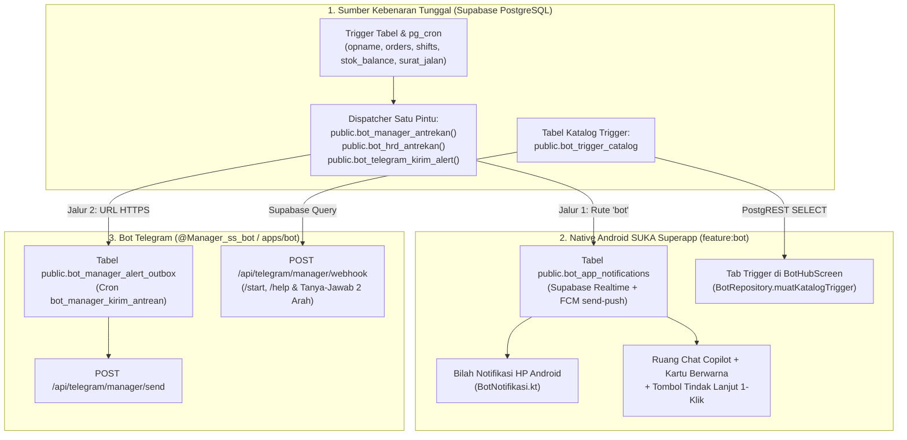

# Standar Sinkronisasi Otomatis Dua Arah: Bot Telegram ↔ Native SUKA Superapp

Dokumen ini merupakan panduan arsitektur dan SOP wajib (**Single Source of Truth**) agar setiap penambahan, perubahan jadwal, maupun pembaruan logika pada **Bot Telegram (`@Manager_ss_bot`, `@Hrd_ss_bot`, `@Stokis_ss_bot`)** atau **Native Android SUKA Superapp (`feature:bot`)** selalu **otomatis tersinkronisasi di kedua platform** tanpa duplikasi manual yang rawan tertinggal.

---

## 1. Arsitektur Satu Pintu (Single Source of Truth di Supabase)

Seluruh ekosistem Bot Suka Shawarma kini menggunakan **2 pilar terpusat di PostgreSQL (Supabase)** sehingga perubahan di sisi database otomatis memperbarui **Telegram** dan **Native Superapp** sekaligus:



---

## 2. Dua Komponen yang Otomatis Tersinkronisasi

### A. Pengiriman Notifikasi Trigger (`public.bot_manager_antrekan`)
Setiap trigger baru atau perubahan aturan jadwal (misal: *Zero Sales 17:00/19:30 WIB* atau *Finalize Stock Opname*) **cukup ditulis satu kali** di fungsi SQL dan memanggil:

```sql
PERFORM public.bot_manager_antrekan(
  p_key      := 'kode_unik_event:' || NEW.id::text,
  p_staff_id := v_staff_id,
  p_title    := '📦 [OPNAME SELESAI] Outlet A (5/12 Cabang)',
  p_body     := 'Rincian pesan lengkap...',
  p_url      := 'https://manager.sukashawarma.com'
);
```

Fungsi `public.bot_manager_antrekan` secara otomatis:
1. **Mengirim ke HP Android (`public.bot_kirim_push_hp`)**:
   - Menyimpan ke `public.bot_app_notifications` dengan `route = 'bot'`.
   - Memicu **Notifikasi Sistem HP** (FCM + Supabase Realtime) dan otomatis menyisipkan pesan ke **Chat Copilot** dengan warna kartu sesuai kategori (`🚨/🛑` Merah, `💸/📦` Oranye, `📋/📊` Hijau).
2. **Mengirim ke Bot Telegram (`public.bot_manager_alert_outbox`)**:
   - Menormalisasi `p_url` menjadi URL HTTPS valid (`https://manager.sukashawarma.com`) jika diisi `'bot'` atau kosong.
   - Mengirimkan pesan ke akun Telegram RM/AM yang tertaut pada menit berikutnya melalui `public.bot_manager_kirim_antrean()`.

---

### B. Daftar Trigger di UI SuperApp & `/help` Telegram (`public.bot_trigger_catalog`)
Agar penambahan/perubahan nama atau jadwal trigger **langsung tampil di Tab "Trigger" Superapp DAN di `/help` Bot Telegram tanpa perlu build ulang APK**, daftar trigger disimpan di tabel **`public.bot_trigger_catalog`**:

| Kolom | Tipe | Penjelasan |
|---|---|---|
| `id` | `text` (PK) | ID unik trigger (contoh: `tg_am_zero_sales_1700`, `tg_rm_opname_finalized`) |
| `target_role` | `text` | Role target: `'regional_manager'`, `'area_manager'`, `'owner'`, `'admin_hr'`, `'kitchen'`, `'purchasing'`, `'admin_finance'`, `'stokist'` |
| `bot_slug` | `text` | `'manager'`, `'ceo'`, `'hrd'`, `'gudang'`, `'finance'` |
| `judul` | `text` | Judul trigger yang tampil di Tab Trigger Superapp & `/help` Telegram |
| `deskripsi` | `text` | Penjelasan cara kerja & ambang batas trigger |
| `jadwal_atau_trigger` | `text` | Label waktu/event (contoh: `'Cron Audit Omzet Sore (17:00 WIB)'`) |
| `is_realtime` | `boolean` | `true` = Event Real-time, `false` = Terjadwal (Cron) |
| `sudah_tertaut_telegram` | `boolean` | Status integrasi ke Telegram (`true`/`false`) |
| `urutan` | `int` | Urutan tampil (1, 2, 3, dst.) |
| `is_active` | `boolean` | Jika `false`, otomatis disembunyikan dari Superapp & Telegram |

**Bagaimana kedua sisi membacanya secara otomatis?**
1. **Native SuperApp (`BotRepository.muatKatalogTrigger`)**:
   Saat pengguna membuka menu **Bot Manager** (atau menarik *refresh*), `BotViewModel.segarkanData()` mengambil baris aktif dari `public.bot_trigger_catalog` sesuai role pengguna dan langsung memperbarui daftar di **Tab Trigger** (dengan fallback ke `BotRoleConfig.kt` jika perangkat sedang offline).
2. **Bot Telegram (`apps/bot/src/app/api/telegram/manager/webhook/route.ts`)**:
   Saat pengguna mengetik `/help` di Telegram, webhook membaca tabel `public.bot_trigger_catalog` sesuai role staf yang tertaut dan merender daftar trigger terbaru secara otomatis.

---

## 3. SOP Saat Menambah / Mengubah Trigger Baru

Setiap kali ada penambahan atau perubahan trigger (baik diminta dari sisi Telegram maupun dari sisi SuperApp), lakukan **3 langkah dalam 1 file migrasi SQL** berikut:

### Langkah 1 — Buat / Perbarui Fungsi Trigger SQL & Panggil `bot_manager_antrekan`
Pastikan fungsi trigger atau `pg_cron` memanggil `public.bot_manager_antrekan(...)` (untuk RM/AM), `public.bot_hrd_antrekan(...)` (untuk HRD), atau `public.bot_telegram_kirim_alert(...)` (untuk Stokis).

### Langkah 2 — `INSERT ... ON CONFLICT DO UPDATE` ke `public.bot_trigger_catalog`
Dalam migrasi SQL yang sama, tambahkan/perbarui baris katalognya:

```sql
INSERT INTO public.bot_trigger_catalog (
  id, target_role, bot_slug, judul, deskripsi, jadwal_atau_trigger, is_realtime, sudah_tertaut_telegram, urutan, is_active
) VALUES (
  'tg_am_contoh_baru',
  'area_manager',
  'manager',
  'Judul Trigger Baru',
  'Deskripsi lengkap kondisi pemicu dan tindakan yang diharapkan.',
  'Trigger / Cron Jadwal WIB',
  true,
  true,
  11,
  true
)
ON CONFLICT (id) DO UPDATE SET
  judul = EXCLUDED.judul,
  deskripsi = EXCLUDED.deskripsi,
  jadwal_atau_trigger = EXCLUDED.jadwal_atau_trigger,
  is_realtime = EXCLUDED.is_realtime,
  urutan = EXCLUDED.urutan,
  is_active = EXCLUDED.is_active,
  updated_at = now();
```

### Langkah 3 — (Opsional) Perbarui Fallback Offline & Tombol Cepat Copilot
Jika trigger baru memiliki kata kunci khusus untuk **Tombol Tindak Lanjut 1-Klik** di Chat Copilot atau fallback offline:
- Perbarui `aksiTindakLanjutUntukNotif()` di `feature/bot/src/main/java/com/sukashawarma/superapp/feature/bot/ui/BotHubScreen.kt`.
- Perbarui daftar fallback offline di `feature/bot/src/main/java/com/sukashawarma/superapp/feature/bot/domain/BotRoleConfig.kt`.

---

## 4. Peta File Penting Lintas Repositori

| Komponen | Lokasi File | Peran dalam Sinkronisasi |
|---|---|---|
| **Dispatcher Push HP & Telegram** | `supabase/migrations/20300254003900_bot_hp_push_notifications.sql` & `20300254004000_bot_rm_am_extra_triggers.sql` | Fungsi `bot_manager_antrekan`, `bot_hrd_antrekan`, `bot_kirim_push_hp` |
| **Katalog Trigger Terpusat** | `supabase/migrations/20300254004200_bot_trigger_catalog_sync.sql` | Tabel `public.bot_trigger_catalog` (dibaca oleh Android & Telegram) |
| **Webhook & `/help` Telegram** | `apps/bot/src/app/api/telegram/manager/webhook/route.ts` | Membaca `bot_trigger_catalog` + fallback AI Router (`tanyaAiRouter` + `ambilTelemetriNyata`) |
| **Endpoint Kirim Telegram** | `apps/bot/src/app/api/telegram/manager/send/route.ts` | Mengirim outbox ke Telegram & menormalisasi `url='bot'` ke `https://manager.sukashawarma.com` |
| **Repository Android Bot** | `SS SUPERAPP/SUPER-APPS-SS-MOBILE/feature/bot/.../data/BotRepository.kt` | `muatKatalogTrigger()`, `muatNotifikasiHpSaya()`, cache riwayat chat & notifikasi |
| **ViewModel Android Bot** | `SS SUPERAPP/SUPER-APPS-SS-MOBILE/feature/bot/.../ui/BotViewModel.kt` | Menggabungkan notifikasi ke riwayat Chat Copilot & menyegarkan katalog trigger dari DB |
| **UI Chat Copilot & Warna Alert** | `SS SUPERAPP/SUPER-APPS-SS-MOBILE/feature/bot/.../ui/BotHubScreen.kt` | Warna kartu notifikasi (Merah/Oranye/Hijau) + Tombol Tindak Lanjut 1-Klik |
